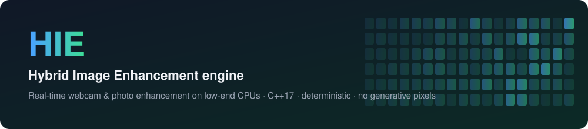
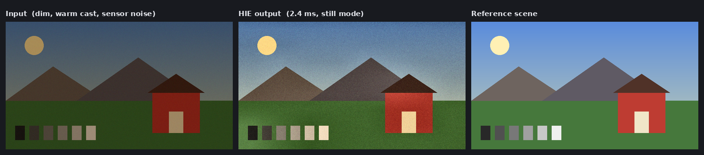
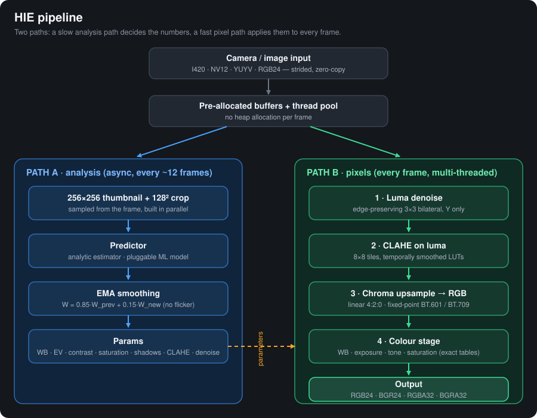
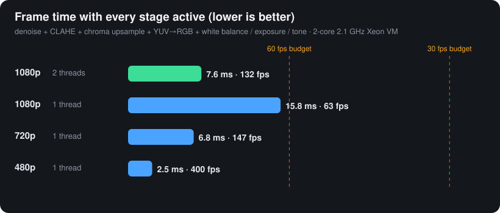
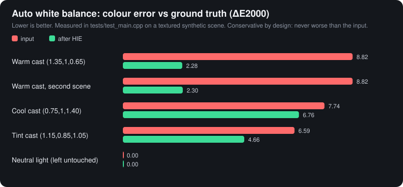

<p align="center">
  
</p>

<p align="center">
  
  
  
  
  
  
  
</p>

**HIE** is a real-time image and webcam enhancement engine written in portable C++17. It improves exposure, white
balance, contrast, noise and colour on cheap sensors **without a GPU and without generating pixels**. Every output pixel is
a deterministic function of the input, so it never invents detail.

It follows the *Hybrid Pixel-Level Image & Webcam Enhancement Architecture*: a slow **analysis path** decides a handful of
parameters a few times per second, and a fast **pixel path** applies them to every frame.

<p align="center">
  
</p>

<sub>A dim, warm-tinted, noisy synthetic scene (left), the HIE result in still-image mode (middle) and the clean scene
(right). Exposure, contrast and noise are recovered; white balance is deliberately only partly corrected here because the
engine refuses to guess when the evidence is weak (see [Colour accuracy](#colour-accuracy)).</sub>

---

## Contents
[Highlights](#highlights) · [How it works](#how-it-works) · [Performance](#performance) ·
[Colour accuracy](#colour-accuracy) · [Quick start](#quick-start) · [API](#api) · [Configuration](#configuration) ·
[Plugging in a neural network](#plugging-in-a-neural-network) · [Project layout](#project-layout) · [Testing](#testing) ·
[Limitations](#limitations) · [Roadmap](#roadmap)

## Highlights

| | |
|---|---|
| **Fast** | 1080p in **7.6 ms** on 2 threads and **15.8 ms** on one thread with every stage active (2.1 GHz VM). |
| **Colour-accurate** | YUV→RGB within **1 level** of a float reference; exact colour stage; neutral scenes are left bit-exact. |
| **No per-frame allocation** | All buffers are pre-allocated; verified by a counting `operator new` test. |
| **Flicker-free** | Parameters are smoothed twice (EMA between analyses, easing between frames); CLAHE tile maps are temporally blended. |
| **Real input formats** | I420, NV12, YUYV (V4L2 webcams), RGB24 in; RGB24, BGR24, RGBA32, BGRA32 out. Odd sizes and strides supported. |
| **Cross-platform core** | One C++17 core, a C API for JNI / Swift / ctypes, and a Linux virtual-webcam tool. |
| **Pluggable brain** | Ships an analytic predictor; drop in IA-3DLUT / Zero-DCE++ / MobileNetV3 outputs through one interface. |
| **Deterministic** | Output is identical for 1, 2, 4 or 7 threads (tested). |

## How it works

<p align="center">
  
</p>

**Path A — analysis (background thread, every ~12 frames).** A 256×256 thumbnail and a native-resolution 128×128 luma
crop are sampled from the frame. A predictor turns them into parameters: white-balance gains, exposure (EV), contrast,
saturation, shadow lift, CLAHE strength and clip, and a denoise threshold derived from a robust noise estimate. New
estimates are blended as `W = 0.85·W_prev + 0.15·W_new`, then eased in per frame, so the picture never jumps.

**Path B — pixels (every frame, all cores).**

1. **Luma-only denoise.** A fast edge-preserving 3×3 bilateral filter on Y. Chroma is untouched, which cuts the math by about two thirds.
2. **CLAHE on luma.** 8×8 tiles, clip-limited, bilinearly interpolated, confined to the legal luma range so colours cannot leave gamut.
3. **Chroma upsample and YUV→RGB.** Linear (centre-sited) 4:2:0 upsampling, Q14 fixed-point BT.601 / BT.709, limited or full range.
4. **Colour stage.** White balance and exposure in linear light, then tone curve, then saturation. Evaluated **exactly** through
   four table lookups per pixel. External `.cube` looks and learned LUT weights go through a **tetrahedral 3D LUT** instead (SSE4.1 kernel plus portable fallback).

## Performance

<p align="center">
  
</p>

| Resolution | Threads | Mean frame | fps | Stage split (denoise / CLAHE / output) |
|---|---|---|---|---|
| 640×480   | 1 | 2.5 ms  | 399 | 0.7 / 0.2 / 1.6 ms |
| 1280×720  | 1 | 6.8 ms  | 147 | 2.0 / 0.3 / 4.5 ms |
| 1920×1080 | 1 | 15.8 ms | 63  | 4.7 / 0.5 / 10.6 ms |
| 1920×1080 | 2 | 7.6 ms  | 132 | 2.2 / 0.4 / 5.0 ms |
| 3840×2160 | 2 | 35.8 ms | 28  | 10.4 / 1.7 / 23.7 ms |

<sub>Measured with `hie_cli bench` on a shared 2-core 2.1 GHz Xeon VM, scene with noise and colour cast so every stage is
active, async analysis on. Results vary by CPU. Real low-end phones and PCs will differ; run the benchmark on your target.
NV12 input costs about the same as I420; YUYV is roughly 35% slower because of extra de-interleaving.</sub>

## Colour accuracy

Colour error is measured in **CIEDE2000 (ΔE)** against ground truth in `tests/test_main.cpp`.

| Check | Result |
|---|---|
| YUV→RGB vs double-precision reference (BT.601/709, limited/full) | max error **1 level** |
| RGB input, neutral parameters | **bit-exact** passthrough |
| Colour stage vs exact float transform | mean 0.008 level, max 1 level |
| 3D LUT path (for `.cube` looks), 17³ tetrahedral | mean ΔE 0.089, p99.9 ΔE 1.8 |
| 3D LUT path, 33³ tetrahedral | mean ΔE 0.026, p99.9 ΔE 1.0 |
| SIMD vs scalar tetrahedral kernels | bit-identical |

<p align="center">
  
</p>

**Why an exact colour stage instead of only a 17³ LUT?** Sampling a non-linear transform on a 17-point grid leaves visible
error (worst case about 10 levels around clipping). HIE evaluates white balance, exposure, tone and saturation with exact
per-channel tables plus one luma-indexed table, which is both faster and more accurate. The 3D LUT stays for external looks.
Details and the sweep that picked the defaults are in [`docs/ACCURACY.md`](docs/ACCURACY.md).

**White balance is conservative on purpose.** It uses gray-edge illuminant estimation and applies a correction only when it
multiplies the share of near-neutral pixels, which is what a real colour cast looks like. In tests it is **never worse than the
input**, leaves neutral scenes at exactly 0.00 ΔE change, strongly fixes warm casts, only partly fixes cool and tinted casts,
and does nothing on scenes with no neutral evidence (for example an all-red wall). A trained model is the intended route
to do better on hard cases.

## Quick start

> New to C++? Follow the step-by-step [Windows and Android setup guide](docs/SETUP_WINDOWS_ANDROID.md).

```bash
git clone <your-repo-url> hie && cd hie
cmake -S . -B build -DCMAKE_BUILD_TYPE=Release
cmake --build build -j
./build/hie_tests                     # 18 suites, 75 checks
```

Requirements: a C++17 compiler (GCC 9+/Clang 10+ recommended) and CMake 3.16+. No other dependencies; `stb_image` /
`stb_image_write` (public domain) are vendored in `third_party/` for the CLI only.

### Enhance a photo

```bash
./build/hie_cli enhance photo.jpg out.png
./build/hie_cli enhance photo.jpg out.png --ev 0.7 --sat 1.1 --no-clahe
./build/hie_cli enhance photo.jpg out.png --cube looks/teal_orange.cube:0.6
```

| Option | Meaning |
|---|---|
| `--no-denoise` `--no-clahe` `--no-lut` | disable a stage |
| `--ev X` `--contrast X` `--sat X` `--lift X` | fix a parameter manually instead of auto |
| `--no-wb` `--wb-strength X` | white balance off / strength 0..1 |
| `--cube file[:weight]` | blend an external `.cube` look |
| `--lut-size 17\|33` `--tri` | 3D LUT size / trilinear instead of tetrahedral |
| `--threads N` | worker threads (0 = auto) |

### Benchmark

```bash
./build/hie_cli bench --sweep --threads 2                 # 480p / 720p / 1080p / 4K
./build/hie_cli bench --width 1920 --height 1080 --in nv12 --rgba --threads 1
```

### Virtual webcam (Linux)

```bash
sudo modprobe v4l2loopback video_nr=10 card_label="HIE Cam" exclusive_caps=1
./build/hie_webcam --in /dev/video0 --out /dev/video10 --width 1280 --height 720
```

Then pick **HIE Cam** in Zoom, Teams, Meet or OBS. See [Limitations](#limitations): this tool has not been run on real hardware yet.

## API

### C++

```cpp
#include <hie/hie.h>

hie::Config cfg;
cfg.width = 1280;  cfg.height = 720;
cfg.in_format  = hie::InFormat::NV12;       // what your camera gives you
cfg.out_format = hie::OutFormat::RGBA32;    // what your renderer wants
cfg.matrix     = hie::Matrix::BT709;        // BT601 for SD / most webcams

hie::Enhancer enh(cfg);                     // allocates everything once
if (!enh.valid()) { /* enh.error() */ }

hie::FrameRing ring(3, 1280 * 720 * 4);     // pre-allocated output buffers
while (camera_has_frame()) {
  auto in = hie::FrameIn::contiguous(cfg.in_format, 1280, 720, camera_ptr());
  enh.process(in, ring.acquire(), 1280 * 4);   // no heap allocation here
}
```

### C (JNI / Swift / ctypes)

```c
#include <hie/hie_c.h>

hie_config c;  hie_config_default(&c, 1280, 720);
c.in_format = 1; /* NV12 */  c.out_format = 2; /* RGBA32 */
hie_handle* h = hie_create(&c);

const uint8_t* planes[3] = { y, uv, NULL };
int strides[3]           = { 1280, 1280, 0 };
hie_process(h, planes, strides, dst, 1280 * 4);
hie_destroy(h);
```

`libhie_c` is built as a shared library with only the C symbols exported.

## Configuration

Every field lives in `hie::Config` (`include/hie/hie.h`). The ones you are most likely to tune:

| Field | Default | Effect |
|---|---|---|
| `analysis_interval` | 12 | frames between analyses (spec: 10–15) |
| `ema_old` | 0.85 | weight of the previous state in the EMA |
| `frame_smoothing` | 0.15 | per-frame easing toward the EMA state (1 = off) |
| `async_analysis` | true | analyse on a background thread (false = inline, deterministic) |
| `threads` | 0 (auto, ≤ 8) | worker threads |
| `auto_wb`, `auto_exposure`, … | true | let Path A drive that parameter; otherwise `manual` is used |
| `wb_strength` | 0.75 | how much of the estimated cast is removed |
| `exposure_strength` | 0.6 | how hard exposure is pulled toward `target_median` |
| `clahe_tiles_x/y`, `clahe_hist_stride` | 8, 2 | CLAHE grid; histogram sub-sampling for speed |
| `lut_size`, `tetrahedral`, `prefer_3d_lut` | 17, true, false | 3D LUT size / interpolation / force the LUT path |
| `chroma_upsample` | Linear | `Nearest` is faster, `Linear` avoids colour fringes |

Time to adapt to a scene change is roughly 2–3 s at 30 fps with the spec's defaults. Lower `analysis_interval` or
raise `frame_smoothing` for snappier response.

## Plugging in a neural network

The analytic predictor is a baseline. To use a trained model (for example an IA-3DLUT regressor, Zero-DCE++ or a MobileNetV3
parameter head through NCNN, ONNX Runtime or LiteRT), implement one method and keep the model out of the hot path:

```cpp
struct MyModel : hie::Predictor {
  void refine(const hie::Thumbnail& t, hie::Params& p) override {
    // t.rgb: 256x256x3 display-referred thumbnail, t.luma_crop: 128x128 native luma
    // p arrives pre-filled with the analytic estimate; overwrite what your model predicts:
    p.wb_r = ...;  p.wb_b = ...;  p.exposure_ev = ...;
    p.lut_weights[0] = ...;       // blend weights for external base LUTs
  }
};
enh.setPredictor(std::make_shared<MyModel>());
hie::Lut3D look;
if (hie::Lut3D::loadCube("base_look_0.cube", look)) enh.addLut(look);   // up to kMaxLuts base LUTs
```

`refine()` runs on the analysis thread, so inference never blocks the frame loop. The EMA and easing apply to whatever the
model returns. **No model weights or inference glue are bundled in this repository.**

## Project layout

```
include/hie/hie.h       public C++ API (Config, Params, Predictor, Enhancer, FrameRing)
include/hie/hie_c.h     C API
src/enhancer.cpp        orchestration: ingest, Path A scheduling, EMA/easing, fused row pass
src/kernels.cpp         denoise, CLAHE, chroma upsample, YUV→RGB (auto-vectorised, x86 runtime dispatch)
src/colorpipe.cpp       exact factored colour stage
src/lut3d.cpp           3D LUT builder, tetrahedral/trilinear kernels, .cube loader
src/analysis.cpp        analytic predictor (gray-edge WB, exposure, noise, ...)
src/threadpool.hpp      allocation-free fork/join pool
tools/hie_cli.cpp       still-image CLI + benchmark
tools/hie_webcam.cpp    V4L2 → HIE → v4l2loopback
tests/test_main.cpp     test suite (incl. CIEDE2000 reference implementation)
docs/                   accuracy notes, README graphics
```

## Testing

```bash
./build/hie_tests               # everything
./build/hie_tests wb            # filter by name
cmake -S . -B build-asan -DHIE_SANITIZE=ON && cmake --build build-asan -j && ASAN_OPTIONS=alloc_dealloc_mismatch=0 ./build-asan/hie_tests
```

The suite covers colour exactness and ΔE, SIMD-vs-scalar equality, white-balance behaviour (including do-no-harm cases),
EMA maths, temporal stability under noise and scene changes, **zero heap allocations per frame**, bit-identical output across thread
counts, I420/NV12/YUYV and output-format equivalence, odd frame sizes, `.cube` LUTs, denoise quality and edge preservation,
and the C API.

## Limitations

Stated plainly so nobody is surprised:

- **No trained model is included.** The "AI brain" is an analytic estimator; the learned-model hook exists but is empty.
- **Auto white balance is a heuristic** and intentionally conservative (see above).
- **Tested on Linux x86-64, Windows and Android (ARM)** with the unit tests and real photographs. iOS and macOS builds are untested.
  ARM relies on compiler auto-vectorisation (no hand-written NEON), and MSVC builds use the scalar LUT kernel.
- **Live webcam** is verified on Windows through `tools/webcam_preview.py`. The Linux `hie_webcam` tool (V4L2 → v4l2loopback) is still untested against real hardware and needs YUYV (no MJPEG decoding).
- **ThreadSanitizer could not run** in the build environment; AddressSanitizer and UBSan are clean and the synchronisation was reviewed by hand.
- **Benchmarks come from a shared VM**, not target low-end hardware.

## Roadmap

Planned for the next release:

- [ ] Android live-webcam support
- [ ] A bundled, trained parameter-regression model (INT8) with NCNN / ONNX Runtime glue

Later:

- [ ] Hand-written NEON kernels for the 3D LUT
- [ ] MJPEG capture, native Windows (Media Foundation) and macOS (AVFoundation) capture layers
- [ ] Android (Camera2 / JNI) and iOS (AVFoundation) sample apps
- [ ] iOS and macOS build verification
- [ ] CI (Linux/macOS/Windows) and a real-photo regression set

## License

Released under the [MIT License](LICENSE). Vendored `third_party/stb_*.h` are public domain.
